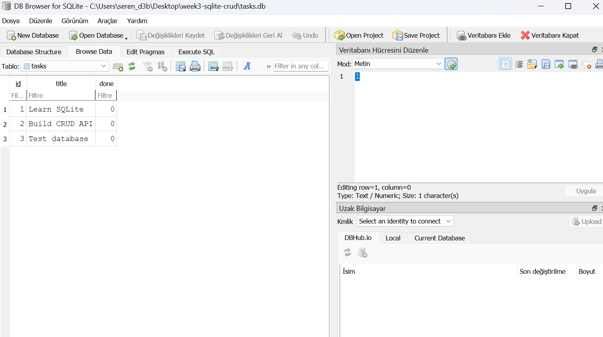

# Week 3 - SQLite CRUD API

## Project Overview

This project is a simple task management API built with Node.js, Express, and SQLite.

I created this project to practice CRUD operations and learn how to connect an API to a database.

In my previous practice, task data was stored in a JavaScript array. In this project, I used SQLite so the tasks can be saved even after restarting the server.

## Technologies Used

- Node.js
- Express.js
- SQLite
- better-sqlite3
- DB Browser for SQLite

## Why I Used SQLite

I chose SQLite because it is simple to use and does not need a separate database server. It stores data in a single file called `tasks.db`.

The database file is created automatically when the application starts.

## How to Run the Project

First, clone the repository and open the project folder.

Install the required packages:

```bash
npm install
```

Start the server:

```bash
node server.js
```

The API runs at:

http://localhost:3000

The application automatically creates the database and the tasks table if they do not exist. It also adds three example tasks when the table is empty.

## API Endpoints

| Method | Endpoint | Description |
|---|---|---|
| GET | /tasks | Get all tasks |
| GET | /tasks/:id | Get a task by ID |
| POST | /tasks | Create a new task |
| PUT | /tasks/:id | Update a task |
| DELETE | /tasks/:id | Delete a task |

## Example Request

POST /tasks

```json
{
  "title": "Learn SQL"
}
```

## SQL Queries

I used DB Browser for SQLite to practice some SQL queries.

For example:

```sql
SELECT * FROM tasks;
```

This query returns all tasks stored in the database.

I also practiced updating tasks and deleting completed tasks.

The SQL queries are saved in the `queries.sql` file.

## Database Screenshot



## What I Learned

In this project, I learned how to connect an Express API to a SQLite database.

I practiced creating tables, inserting tasks, reading data, updating records, and deleting tasks using SQL.

I also learned that using a database allows data to remain available after restarting the server.