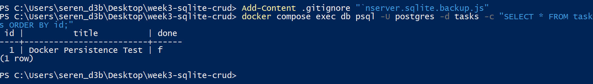

# Task CRUD API - PostgreSQL and Docker

## Project Overview

This project is a simple task management REST API built with Node.js, Express, PostgreSQL, and Docker.

It is an updated version of my previous SQLite CRUD project. I changed the database from SQLite to PostgreSQL and used Docker Compose to run the API and database together.

## Technologies Used

- Node.js
- Express.js
- PostgreSQL 18
- Docker and Docker Compose
- node-postgres (pg)
- dotenv

## Project Structure

- server.js - Express API and routes
- repository.js - PostgreSQL database operations
- init.sql - Creates the table and inserts example tasks
- Dockerfile - Builds the Node.js application
- compose.yaml - Starts the API and database
- .env.example - Example environment variables

## How to Run

1. Clone this repository.
2. Copy .env.example to .env.
3. Replace YOUR_PASSWORD in .env with a local database password.
4. Run:

```bash
docker compose up --build
```

The API is available at:

http://localhost:3000

Docker Compose starts the Node.js API and PostgreSQL database.

## API Endpoints

| Method | Endpoint | Description |
|---|---|---|
| GET | /tasks | Get all tasks |
| GET | /tasks/:id | Get one task |
| POST | /tasks | Create a task |
| PUT | /tasks/:id | Update a task |
| DELETE | /tasks/:id | Delete a task |

## Example Request

```bash
curl -i http://localhost:3000/tasks
```

Example response:

```json
[
  {
    "id": 1,
    "title": "Learn PostgreSQL",
    "done": false
  }
]
```

The example response illustrates the API format. Actual data may differ.

## Database

PostgreSQL runs inside a Docker container.

The tasks table contains:

- id - Primary key
- title - Task title
- done - Boolean completion status

All SQL queries are handled in repository.js using parameterized queries.

The API keeps the same endpoints and validation rules as the previous version. The route implementation was updated to call the new PostgreSQL repository because the original SQLite queries were written directly inside server.js.

## Automatic Database Setup

When PostgreSQL initializes a new database, init.sql creates the tasks table.

If the table is empty, three example tasks are inserted:

- Learn PostgreSQL
- Build CRUD API
- Test Docker

I tested this using a separate Docker Compose project with an empty database volume.

## Persistence Test

I created a task called "Docker Persistence Test" through the API.

Then I ran:

```bash
docker compose down
docker compose up -d
```

After restarting the containers, I checked the database:

```sql
SELECT * FROM tasks;
```

The task was still present.

This confirms that the Docker volume preserves PostgreSQL data across container restarts.

## Database Screenshot



## What I Learned

I learned how to run PostgreSQL in Docker, connect an Express API to a database server, and use Docker Compose to start multiple services.

I also practiced environment variables, SQL queries, database repositories, and persistent Docker volumes.

## Verified HTTP Response

I tested the API using curl:

```bash
curl -i http://localhost:3000/tasks
```

Actual response:

```http
HTTP/1.1 200 OK
Content-Type: application/json; charset=utf-8

[{"id":1,"title":"Docker Persistence Test","done":false}]
```
